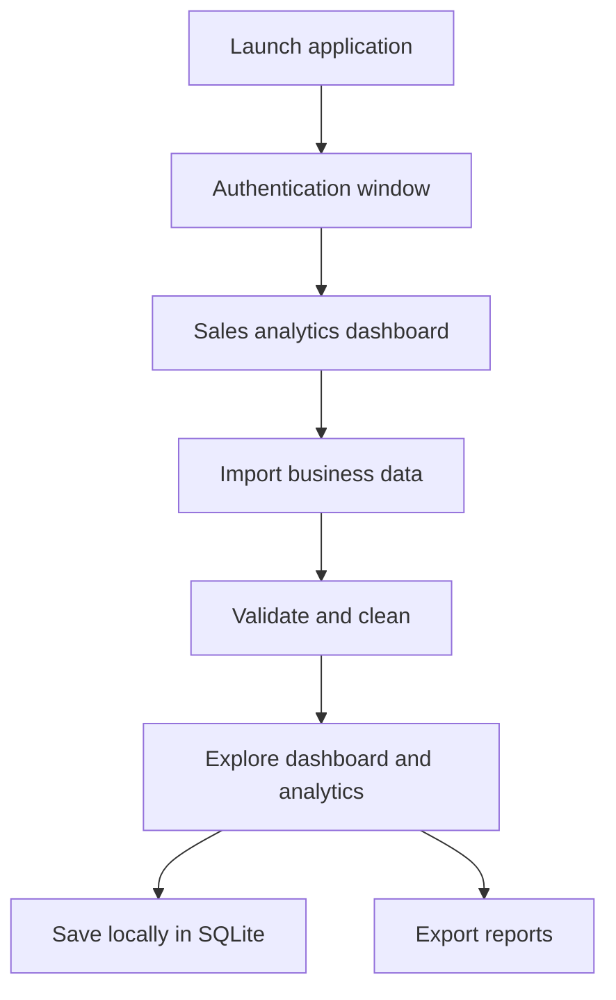

# 📊 Sales & Inventory Analytics System

<div align="center">

**A bilingual Python desktop application for exploring sales performance, inventory, and customer behavior.**

[](https://www.python.org/)
[](https://github.com/TomSchimansky/CustomTkinter)
[](https://www.sqlite.org/)
[](LICENSE)

</div>

> [!CAUTION]
> **Security notice — this repository is not production-ready.** The current Git history includes local SQLite database files and a runtime user file. The authentication implementation also seeds a known demo administrator account and hashes passwords with plain SHA-256. Do not use the committed database files, real credentials, or real customer data with this application. Read [SECURITY.md](SECURITY.md) before running or deploying it.

---

## Overview

Sales & Inventory Analytics System is a desktop application for importing tabular business data, cleaning it, exploring key sales and inventory metrics, and exporting reports. Its interface supports Persian and English.

The application is designed as a local analytics prototype. It is not an ERP replacement or a hardened multi-user production system.

## Features

### Data import and preparation

- Import Excel and CSV files.
- Import from supported external sources through the import module, including Google Sheets, Dropbox, REST endpoints, and database connections.
- Validate required sales-data columns.
- Clean empty rows, missing required values, invalid dates, invalid numeric values, negative values, and duplicate rows.
- Preview imported and cleaned data.

### Analytics

The current analytics module exposes these 11 analysis outputs:

1. Daily sales report.
2. Seven-day inventory forecast.
3. Slow-moving products.
4. Sales trend.
5. Conversion rate.
6. Basket analysis.
7. Customer churn analysis.
8. Top- and low-performing products.
9. Low-stock alerts.
10. RFM customer segmentation.
11. Sales-funnel conversion.

The available results depend on the columns and quality of the imported dataset. Forecasts and customer metrics should be treated as exploratory outputs, not business guarantees.

### Dashboard and reporting

- Quick summary metrics for sales, customers, products, and records.
- Interactive charts rendered with Matplotlib.
- Dark and light appearance modes.
- Persian and English interface text.
- Export helpers for Excel, PDF, and HTML reports.
- Local persistence through SQLite.

## Technology

| Area | Tools |
|---|---|
| Desktop UI | CustomTkinter, Tkinter |
| Language | Python |
| Data processing | Pandas, NumPy |
| Visualization | Matplotlib |
| Spreadsheet support | OpenPyXL |
| HTTP integrations | Requests |
| Local storage | SQLite |
| Tests | pytest |

## Application flow



## Getting started

### Requirements

- Python 3.10 or a compatible Python environment.
- pip.
- Windows, macOS, or Linux with a working Tkinter installation.

### 1. Clone the repository

```bash
git clone https://github.com/kiannaseri/Sales-Inventory-Analytics-System.git
cd Sales-Inventory-Analytics-System
```

### 2. Create and activate a virtual environment

**Windows (PowerShell):**

```powershell
python -m venv .venv
.venv\Scripts\Activate.ps1
```

**macOS / Linux:**

```bash
python3 -m venv .venv
source .venv/bin/activate
```

### 3. Install application dependencies

The application source and its dependency file are inside the `data/` directory:

```bash
python -m pip install --upgrade pip
python -m pip install -r data/requirements.txt
```

### 4. Launch the application

```bash
cd data
python main.py
```

Use the registration screen to create a local account. **Do not use the application with real credentials or sensitive business data** until the authentication and repository-security issues described in [SECURITY.md](SECURITY.md) have been resolved.

## Run tests

From the repository root:

```bash
python -m pip install -r data/requirements-dev.txt
python -m pytest -q
```

The current test suite focuses on data cleaning and required-column validation.

## Expected input columns

The data-cleaning and analytics modules use the following fields:

| Column | Purpose |
|---|---|
| `date` | Transaction or activity date |
| `product` | Product name |
| `sales_amount` | Sales value |
| `quantity_sold` | Units sold |
| `customer_id` | Customer identifier |
| `current_inventory` | Current stock quantity |

Some analytics use additional optional fields, such as `product_views`, `add_to_cart`, `checkout_start`, `successful_purchase`, `category`, and `alert_threshold`.

## Repository structure

```text
Sales-Inventory-Analytics-System/
├── README.md
├── SECURITY.md
├── LICENSE
├── tests/
│   └── test_data_cleaner.py
└── data/
    ├── main.py
    ├── auth.py
    ├── app.py
    ├── analytics.py
    ├── data_cleaner.py
    ├── database.py
    ├── import_sources.py
    ├── exports.py
    ├── languages.py
    ├── theme_manager.py
    ├── requirements.txt
    └── requirements-dev.txt
```

## Security and production readiness

Before using this project beyond local experimentation:

- Remove tracked local databases and runtime identity files from the repository after backing up anything that must be retained.
- Treat any real personal data or credentials committed in the past as potentially exposed.
- Replace the known demo administrator setup.
- Replace plain SHA-256 password hashing with a password-hashing algorithm designed for credentials, such as Argon2id, scrypt, or bcrypt.
- Review password recovery, session handling, access control, and database storage.
- Keep secrets and real business data outside Git.

See [SECURITY.md](SECURITY.md) for the full checklist. Adding files to `.gitignore` does not remove files that Git already tracks.

## License

This project is distributed under the MIT License. See [LICENSE](LICENSE).

---

<div align="center">

**Built by [Kian Naseri](https://github.com/kiannaseri)**

</div>
